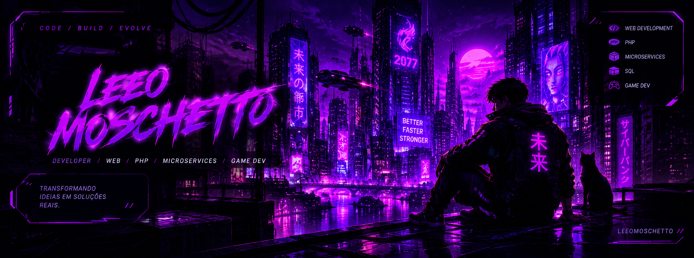

 <div align="center">



<br/>

# 🟣 LEEO MOSCHETTO

### DESENVOLVEDOR DE SOFTWARE • TECNOLOGIA • INOVAÇÃO

`CÓDIGO` // `CONSTRUIR` // `EVOLUIR`


</div>

---

## 👾 // SOBRE MIM

Olá! Eu sou **LeeoMoschetto**, desenvolvedor apaixonado por tecnologia, arquitetura de software e criação de soluções digitais.

🎓 **Formação:** Análise e Desenvolvimento de Sistemas — concluído.

📚 **Atualmente:** finalizando a graduação em Engenharia de Software.

💻 Tenho interesse e experiência em diferentes áreas do desenvolvimento, buscando criar soluções organizadas, eficientes e que resolvam problemas reais.

```text
> INICIALIZANDO PERFIL...
> ÁREA: DESENVOLVIMENTO DE SOFTWARE
> FOCO: TECNOLOGIA E SOLUÇÕES DIGITAIS
> STATUS: EM CONSTANTE EVOLUÇÃO
```

---

## ⚙️ // ARSENAL TECNOLÓGICO

<div align="center">

### 💻 DESENVOLVIMENTO WEB


### 🗄️ BANCOS DE DADOS


### 🧠 ÁREAS DE ATUAÇÃO E INTERESSE


</div>

---

## 🚀 // ARQUIVO DE PROJETOS

### 👟 01 — CATÁLOGO STREETWEAR

> Um catálogo digital de tênis desenvolvido para apresentar produtos de maneira organizada, moderna e visualmente atraente.

**Funcionalidades do projeto:**

- Exibição de produtos com imagens.
- Informações de preços, numerações e cores.
- Organização visual do catálogo.
- Interface construída com HTML, CSS e JavaScript.

**Tecnologias utilizadas:**


<div align="center">

<a href="https://github.com/LeeoMoschetto/catalogo-streetwear">
  
</a>

</div>

> **STATUS DO PROJETO:** desenvolvimento e preparação para publicação.

---

## 🎓 // FORMAÇÃO ACADÊMICA

<div align="center">


**Graduação concluída**

<br/>


**Graduação em andamento — fase final**

</div>

---

## 📊 // SYSTEM STATUS — GITHUB

<div align="center">


<br/><br/>


</div>

<sub>Os cartões dependem de serviços externos e podem apresentar indisponibilidade. As linguagens exibidas representam os repositórios analisados, não uma avaliação do nível de conhecimento.</sub>

---

## 🌌 // FILOSOFIA DE DESENVOLVIMENTO

<div align="center">

### `O FUTURO É CONSTRUÍDO COM CÓDIGO.`

*Disciplina hoje. Evolução constante. Resultados amanhã.*

<br/>


<br/><br/>

**[ SISTEMA ATIVO ] — [ PRÓXIMO NÍVEL: EM CONSTRUÇÃO ]**

</div>

---

<div align="center">

<sub>LEEO MOSCHETTO © • DESENVOLVIDO COM CURIOSIDADE, CÓDIGO E CRIATIVIDADE</sub>

</div>
