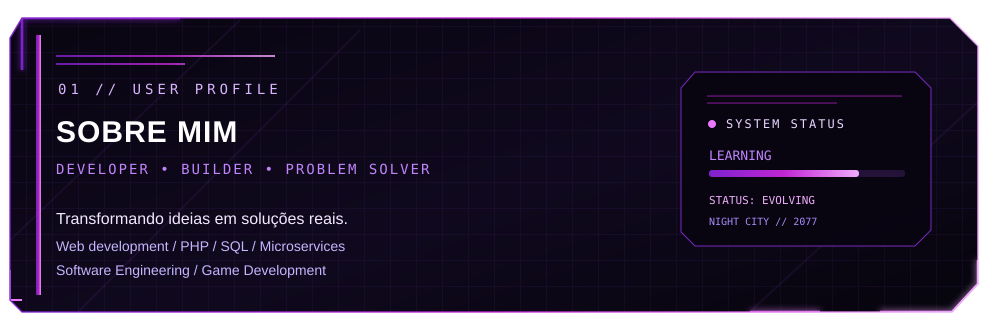
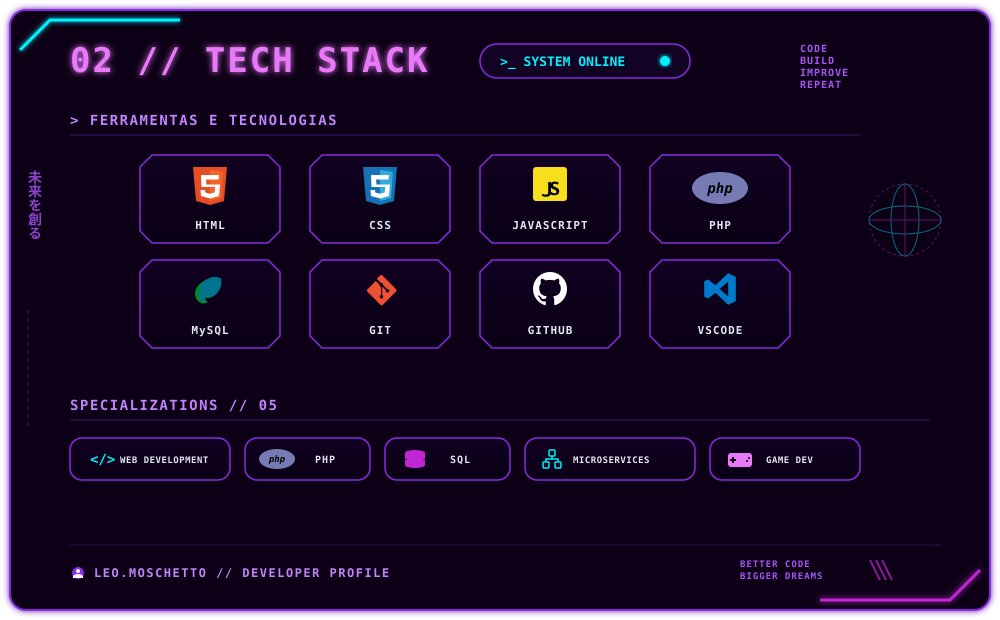
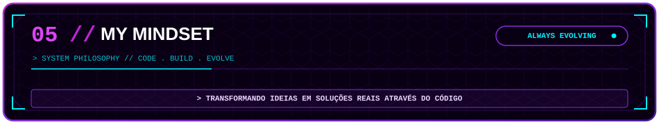

<!-- BANNER CYBERPUNK COM CHUVA ANIMADA -->

  

 

  

   

  

  

---

<h2 align="center">
  
</h2>

  <!-- PAINEL CYBERPUNK: SOBRE MIM -->
  

    

  

    

  

    Desenvolvedor apaixonado por tecnologia, focado em transformar ideias em soluções funcionais por meio do código.
  

   

  <!-- BLOCOS DE FORMAÇÃO ACADÊMICA TIPO HUD -->
  <h3><code>// FORMAÇÃO ACADÊMICA</code></h3>
   

  

    
      
    
  

   

  <!-- ÁREAS DE INTERESSE EM FORMATO CYBERPUNK -->
  <h3><code>// ÁREAS DE INTERESSE</code></h3>
   

  

    
    
    
    
    
  

  <h2 align="center">
  
</h2>

  

---

<h2 align="center">
  
</h2>

  

---

<h2 align="center">
  
</h2>

  <!-- PAINEL CYBERPUNK: GITHUB STATUS -->
  

    

  <!-- CARTÕES CUSTOMIZADOS NO TEMA NEON (FUNDO #090014, BORDAS #8A2BE2 / #00F0FF) -->
  
  
  

    

  <!-- STREAK STATS CUSTOMIZADO -->
  

---

<h2 align="center">
  
</h2>

  <!-- PAINEL CYBERPUNK: MENTALIDADE -->
  

    

  

    Acredito que cada projeto é uma oportunidade de aprender, evoluir e transformar ideias em soluções reais. 
    Meu objetivo é continuar a desenvolver as minhas competências, explorar novas tecnologias e construir projetos cada vez melhores.
  

   

  

  

<!-- RODAPÉ CYBERPUNK -->

  

   

  <samp>O FUTURO É CONSTRUÍDO COM CÓDIGO.</samp>

    

  

